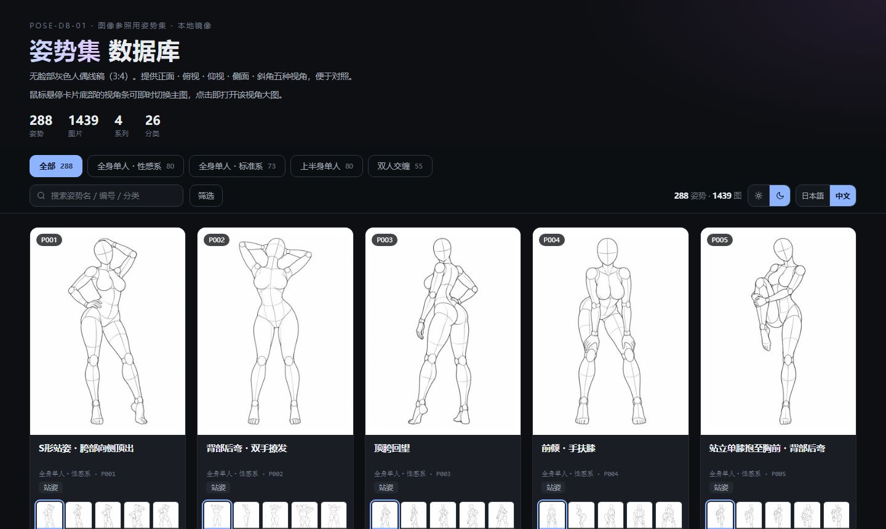
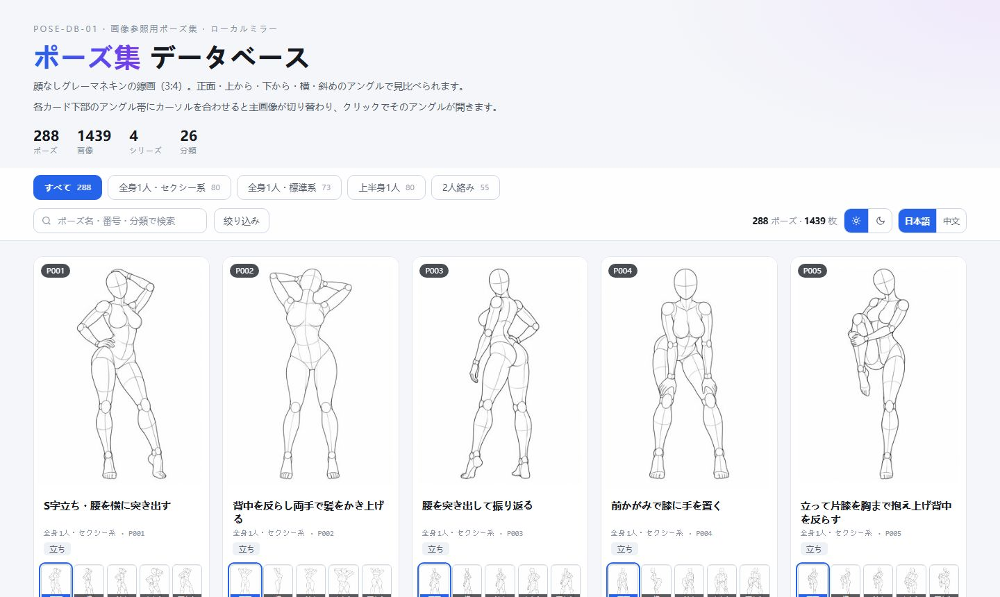

# AI Pose Gallery · 中文版

**288 个姿势 / 1439 张多视角参考图，日文元数据完整汉化**

零依赖静态画廊 · 双主题 · 中日双语 · 双击即开

[中文](#中文) · [日本語](#日本語) · [English](#english)

> ⚠️ **图片素材著作权归原作者 ギア 所有，原站条款禁止再分发。本仓库不含任何图片文件。**
> 详见 [NOTICE.md](NOTICE.md)。

---

# 中文

## 📖 项目简介

> **AI Pose Gallery 中文版**是 [ai-pose-gallery.pages.dev](https://ai-pose-gallery.pages.dev/) 的元数据镜像与汉化项目。
> 原站是一套面向 AI 绘画 / 3D / 插画的人体姿势参考图库，元数据全为日文，不提供批量下载与检索。
> 本项目把 323 条日文元数据全部译为中文，并重写了一套零依赖的静态画廊。

原作者：ギア（[@giaaibusi](https://x.com/giaaibusi)）

## ✨ 核心特性

- 🎯 **完整汉化**：4 个系列 / 26 个分类 / 288 个姿势名 / 5 个视角，共 323 条唯一译词，零遗漏
- 🖼️ **角度条交互**：每张卡片底部 5 格真实缩略图，**悬停即换主图**，点击直接进入对应视角
- 📐 **双视图**：按姿势分组（288 卡）/ 逐张浏览（1439 张），一键切换
- 🔀 **四种排序**：系列 → 编号（默认，同原站）/ 编号 / 分类 / 姿势名
- 🔍 **双向搜索**：输入中文或日文都能命中，编号、姿势名、分类皆可
- 🔎 **灯箱**：缩略图 → 原图渐进加载，`←` `→` 切视角，`↑` `↓` 换姿势，`Esc` 关闭，触摸可滑动
- 🌗 **双主题**：浅色 / 深色，CSS 变量驱动，localStorage 记忆，首帧前套用不闪白
- 🌐 **双语切换**：日本語 / 中文实时切换，无需刷新
- 📦 **零依赖**：单个 HTML 文件，数据内嵌，**`file://` 双击即开**，不需要起服务器
- 📊 **数据可复用**：中文记录、元数据、日⇄中对照表全部导出为 JSON / CSV
- 🔎 **SEO 就绪**：robots.txt / sitemap.xml / 404.html / og-cover / JSON-LD 结构化数据


## 📸 页面预览

| 暗色 · 中文 | 浅色 · 日文 |
|:---:|:---:|
|  |  |

> 截图中的素材已做模糊处理，仅演示界面结构。

## 📊 数据规模

| 系列 | 图片数 | 姿势数 |
|---|---:|---:|
| 全身单人・性感系 | 399 | 80 |
| 全身单人・标准系 | 365 | 73 |
| 上半身单人 | 400 | 80 |
| 双人缠绵 | 275 | 55 |
| **合计** | **1439** | **288** |

> P018 缺「仰视」视角，故为 1439 而非 1440（288 × 5）。

### 视角

| 日文 | 中文 | 说明 |
|---|---|---|
| 正面 | 正面 | 正面平视 |
| 横 | 侧面 | 正侧方 |
| 斜め | 斜角 | 45° 斜前方 |
| 上から | 俯视 | 高位俯拍 |
| 下から | 仰视 | 低位仰拍 |

## 🛠️ 技术栈

| 技术 | 用途 |
|---|---|
| 原生 HTML / CSS / JS | 无框架、无构建、无 npm 依赖 |
| CSS 自定义属性 | 双主题切换的全部色值 |
| `localStorage` | 主题与语言偏好持久化 |
| Python 3 | 抓取、翻译、构建脚本 |
| Chrome Headless | 生成 og-cover 与预览截图 |

**刻意不使用**：React / Vue、打包工具、CDN、外部字体、任何第三方库。

## 📁 项目结构

```
.
├── index.html              # 单页画廊（数据内嵌，file:// 可直开）
├── DEPLOY.md               # 两个站点的联合部署手册（VPS / Cloudflare）
├── robots.txt
├── sitemap.xml
├── 404.html
├── og-cover.jpg            # 1200×630 社交分享封面（自制纯排版）
├── docs/                   # 界面预览截图（素材已模糊）
├── manifest.json           # 全量清单（含原始 URL 与本地路径）
├── manifest.csv            # 同上，Excel 可直接打开
├── data/
│   ├── pose.json           # 原始日文数据（未改动，1439 条）
│   ├── pose-zh.json        # 中文数据（含中日对照字段）
│   ├── meta.json           # 系列 / 分类 / 视角元数据
│   └── translations.csv    # 日⇄中对照表（323 条）
├── scripts/
│   ├── extract.py          # 从原站存档解析内嵌数据
│   ├── manifest.py         # 生成清单
│   ├── download.py         # 并发下载器（断点续传）
│   ├── translations.py     # 日→中词典
│   ├── build_gallery.py    # 构建 index.html + data/ + SEO 文件
│   ├── build_dist.sh       # 生成部署目录 dist/
│   └── verify.py           # 校验文件完整性
├── thumbs/                 # 缩略图（gitignored）
├── img/                    # 原图（gitignored）
└── raw/                    # 原站存档（gitignored）
```

## ⚙️ 环境要求

| 环境 | 版本 | 说明 |
|---|---|---|
| Python | 3.8+ | 运行脚本需要 |
| 浏览器 | 任意现代浏览器 | 打开 `index.html` |
| 磁盘空间 | 约 660 MB | 存放 1439 张缩略图 + 原图 |
| 网络 | 仅首次下载需要 | 下载完成后完全离线 |

## 🚀 快速开始

```bash
# 1. 克隆
git clone https://github.com/Brilliant666/ai-pose-gallery-cn.git
cd ai-pose-gallery-cn

# 2. 下载素材（断点续传，已存在的自动跳过）
python scripts/download.py thumb 16    # 缩略图 300×400 JPG，约 22 MB
python scripts/download.py full 14     # 原图   900×1200 PNG，约 638 MB

# 3. 打开
#    Windows: 双击 index.html
#    macOS:   open index.html
#    Linux:   xdg-open index.html
```

> 不需要 `npm install`，不需要起 HTTP 服务。数据内嵌在 HTML 里，`file://` 协议直接可用。

## 📦 生产部署

纯静态站点，任意静态托管都能跑。

### Cloudflare Pages

```bash
bash scripts/build_dist.sh
npx wrangler pages deploy dist --project-name ai-pose-gallery-cn
```

### 自有 VPS + nginx

```bash
# 构建（SITE_URL 决定 canonical / og:url / sitemap 的绝对地址）
SITE_URL=https://your-domain.com python scripts/build_gallery.py

# 上传
rsync -avz --exclude raw --exclude dist ./ user@host:/var/www/pose/
```

nginx 关键配置：

```nginx
# 图片内容永不变 → 一年强缓存
location ~ ^/(thumbs|img)/ {
    add_header Cache-Control "public, max-age=31536000, immutable" always;
    access_log off;
}

# HTML 每次验证
location ~* \.(html|json|csv)$ {
    add_header Cache-Control "no-cache, must-revalidate" always;
}

# 1400+ 小文件，开元数据缓存
open_file_cache max=10000 inactive=60s;
```

## 🗄️ 数据结构

`data/pose-zh.json` 每条记录：

| 字段 | 说明 | 示例 |
|---|---|---|
| `id` | 唯一标识 | `full_sexy_P001_front` |
| `系列` / `系列_zh` | 日文 / 中文系列名 | 全身1人・セクシー系 / 全身单人・性感系 |
| `分类` / `分类_zh` | 日文 / 中文分类名 | 立ち / 站姿 |
| `姿势编号` | 组内编号 | `P001` |
| `姿势名` / `姿势名_zh` | 日文 / 中文姿势名 | S字立ち・腰を横に突き出す / S形站姿・胯部向侧顶出 |
| `视角` / `视角_zh` | 日文 / 中文视角名 | 正面 / 正面 |
| `缩略图` / `原图` | 相对路径 | `thumbs/…jpg` / `img/…png` |

## 🔒 版权与许可

| 内容 | 权利人 | 许可 |
|---|---|---|
| 代码（`scripts/`、`index.html` 内 HTML/CSS/JS） | Brilliant666 | **MIT** |
| 中文译文与结构化整理（`data/`） | Brilliant666 | **CC BY 4.0** |
| 图片素材 | ギア | **不在本仓库，不授予任何权利** |
| 原始日文元数据 | ギア | 归原作者所有 |

原站条款原文：

> 画像データそのもの（元サイズ・加工後を含む）の**再配布・転載・再販は禁止**です。

| 用途 | 是否允许 |
|---|---|
| 拿图做作品、商用创作、编辑、临摹参考 | ✅ 允许 |
| 把图片文件本身再分发、转载、转售 | ❌ 禁止 |

本仓库是个人学习与技术实践存档，**不构成对原作品任何形式的授权**。
如原作者认为内容侵权，请提交 Issue，将立即删除。

## 🐛 常见问题

| 问题 | 原因 | 解决 |
|---|---|---|
| 打开是空白页 | 图片还没下载 | 先跑 `download.py` |
| 图片显示不出来 | 目录结构被改过 | 保持 `thumbs/` `img/` 与 `index.html` 同级 |
| 中文模式看到日文 | 该条缺译 | 正常回退，不会报错；可提 PR 补译 |
| 想改域名 | canonical 是占位值 | `SITE_URL=... python scripts/build_gallery.py` |
| 换设备后主题丢失 | localStorage 按域隔离 | 重新选一次即可 |

## 📝 更新日志

| 日期 | 变更 |
|---|---|
| 2026-10-29 | 仓库化：拆 scripts/ 与 data/、补 SEO 全套、加 NOTICE 与三层许可；交叉校验修正 5 处译名 |
| 2026-10-27 | 初版：全量镜像 1439 张、323 条汉化、单文件画廊 |

## 🤝 贡献指南

欢迎补充译文、修正错译、报告 bug。

- 译文在 `scripts/translations.py`，改完跑 `python scripts/build_gallery.py` 重新生成
- 提交前请确保 `python scripts/verify.py` 通过
- **请勿提交任何图片文件**，`thumbs/` `img/` `raw/` 已在 `.gitignore` 中

## 📄 开源协议

代码 [MIT](LICENSE) · 译文与整理 [CC BY 4.0](https://creativecommons.org/licenses/by/4.0/deed.zh) · 图片不授权

## 💡 致谢

- 原始素材与日文元数据：ギア（[@giaaibusi](https://x.com/giaaibusi)）
- 中文译文交叉校验：[anhao/ai-pose-gallery-zh](https://github.com/anhao/ai-pose-gallery-zh)（据此修正 5 处译名）

## 📧 联系方式

有问题请开 [Issue](https://github.com/Brilliant666/ai-pose-gallery-cn/issues)。

---

# 日本語

## 📖 概要

> [ai-pose-gallery.pages.dev](https://ai-pose-gallery.pages.dev/) のメタデータを完全に中国語化し、
> 依存ゼロの静的ギャラリーを付け直したプロジェクトです。

原作者：ギア（[@giaaibusi](https://x.com/giaaibusi)）

## ✨ 主な機能

- 🎯 **完全な中国語化**：4 系列 / 26 分類 / 288 ポーズ名 / 5 アングル、計 323 語
- 🖼️ **アングル帯**：カード下部に 5 枚のサムネイル、ホバーでメイン画像が切り替わる
- 📐 **2 つの表示**：ポーズごと（288 枚）/ 1 枚ずつ（1439 枚）
- 🌗 **2 テーマ**：ライト / ダーク、設定は保存される
- 🌐 **2 言語**：日本語 / 中文をその場で切り替え
- 📦 **依存ゼロ**：単一 HTML、データ埋め込み、`file://` でそのまま開ける


## 📸 画面プレビュー

| ダーク · 中文 | ライト · 日本語 |
|:---:|:---:|
|  |  |

> スクリーンショット内の素材はぼかし処理済みです（UI 構造の説明用）。

## 📊 データ規模

| 系列 | 画像数 | ポーズ数 |
|---|---:|---:|
| 全身1人・セクシー系 | 399 | 80 |
| 全身1人・標準系 | 365 | 73 |
| 上半身1人 | 400 | 80 |
| 2人絡み | 275 | 55 |
| **合計** | **1439** | **288** |

## 🚀 クイックスタート

```bash
git clone https://github.com/Brilliant666/ai-pose-gallery-cn.git
cd ai-pose-gallery-cn

python scripts/download.py thumb 16   # サムネイル 約 22 MB
python scripts/download.py full 14    # 原寸 PNG 約 638 MB

# index.html をブラウザで開くだけ（サーバー不要）
```

## 🔒 ライセンス

| 内容 | ライセンス |
|---|---|
| コード | MIT |
| 中国語訳・データ整理 | CC BY 4.0 |
| 画像 | **本リポジトリに含まず、いかなる権利も付与しない** |

> 画像データそのものの再配布・転載・再販は禁止です。著作権は原作者 ギア に帰属します。

---

# English

## 📖 Overview

> A fully localized (Chinese) metadata mirror of [ai-pose-gallery.pages.dev](https://ai-pose-gallery.pages.dev/),
> plus a dependency-free static gallery rebuilt from scratch.

Original author: ギア（[@giaaibusi](https://x.com/giaaibusi)）

## ✨ Features

- 🎯 **Full localization**: 4 series / 26 categories / 288 pose names / 5 angles — 323 terms
- 🖼️ **Angle strip**: 5 real thumbnails under each card; hover swaps the main image, click opens that angle
- 📐 **Two views**: grouped by pose (288 cards) or one card per image (1439)
- 🔀 **Four sort modes**, 🔍 **bidirectional search** (Chinese ↔ Japanese)
- 🔎 **Lightbox**: progressive thumb → full image, `←` `→` angle, `↑` `↓` pose, `Esc` close, touch swipe
- 🌗 **Dual theme** and 🌐 **bilingual UI** with persisted preferences
- 📦 **Zero dependencies**: one HTML file with embedded data — opens via `file://`, no server needed


## 📸 Preview

| Dark · Chinese | Light · Japanese |
|:---:|:---:|
|  |  |

> Artwork in the screenshots is blurred; they only illustrate the UI structure.

## 📊 Scale

| Series | Images | Poses |
|---|---:|---:|
| Full body · sexy | 399 | 80 |
| Full body · standard | 365 | 73 |
| Upper body | 400 | 80 |
| Two people | 275 | 55 |
| **Total** | **1439** | **288** |

## 🚀 Quick start

```bash
git clone https://github.com/Brilliant666/ai-pose-gallery-cn.git
cd ai-pose-gallery-cn

python scripts/download.py thumb 16   # thumbnails, ~22 MB
python scripts/download.py full 14    # full-size PNGs, ~638 MB

# then just open index.html in a browser
```

## 🔒 License

| Content | License |
|---|---|
| Code | MIT |
| Chinese translations & data organization | CC BY 4.0 |
| Images | **Not included; no rights granted** |

> Redistribution, reposting or resale of the image data itself is prohibited.
> All image copyrights belong to the original author, ギア.

---

## ⚠️ Content notice

素材为成人向人体姿势参考，部分分类名称涉及性行为术语。
仅供艺术创作、动作研究与前端技术学习使用。**未成年人请勿访问。**

Adult-oriented pose reference material. For art creation, motion study and front-end learning only. **Not for minors.**
