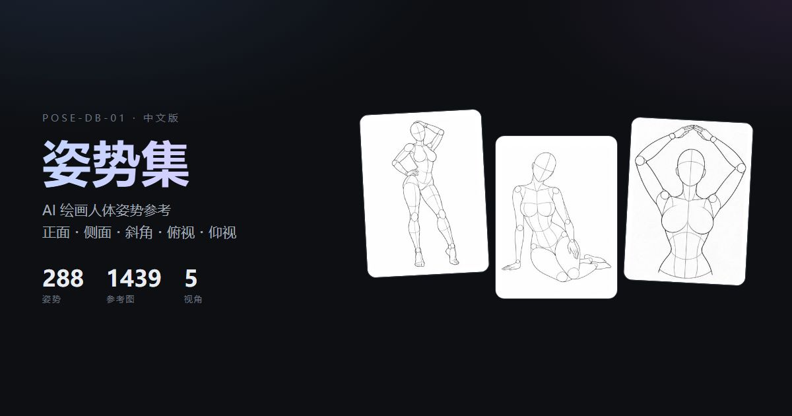

# AI Pose Gallery · 中文版

> 288 个姿势 / 1439 张多视角参考图，日文元数据完整汉化，零依赖静态画廊。



**原始站点**：[ai-pose-gallery.pages.dev](https://ai-pose-gallery.pages.dev/)
**原作者**：ギア（[@giaaibusi](https://x.com/giaaibusi)）

---

## ⚠️ 关于素材版权（请先读）

本仓库**只包含代码与元数据，不包含任何图片**。

- 图片著作权归原作者 **ギア** 所有，原站条款**禁止再分发、转载、转售图片文件本身**
- 允许拿图做作品、商用创作、编辑与参考
- 本仓库不构成对原作品的任何授权。详见 [NOTICE.md](NOTICE.md)

图片需要你自己运行 `scripts/download.py` 从原始站点获取，供个人参考使用。

---

## 这是什么

原站是一套面向 AI 绘画 / 3D / 插画的人体姿势参考图库，元数据全为日文，不提供批量下载。本项目做了三件事：

1. **完整汉化** —— 4 个系列 / 26 个分类 / 288 个姿势名 / 5 个视角，共 323 条唯一译词，零遗漏
2. **可用的前端** —— 零依赖单文件画廊，数据内嵌，**双击 `index.html` 就能看**（不需要起服务器）
3. **可复用的数据** —— 中文记录、元数据、日⇄中对照表全部导出为 JSON / CSV

## 功能

- **系列 Tab**：4 个系列，带姿势计数
- **卡片角度条**：每张卡片底部 5 格真实缩略图（正面 / 侧面 / 斜角 / 俯视 / 仰视），**悬停即换主图**，点击进入对应视角
- **双视图**：按姿势分组 / 逐张浏览
- **排序**：系列 → 编号（默认，同原站）/ 编号 / 分类 / 姿势名
- **搜索**：编号、姿势名、分类，中/日文双向命中
- **灯箱**：缩略图 → 原图渐进加载，`←` `→` 切视角，`↑` `↓` 换姿势，`Esc` 关闭，触摸可滑动
- **双主题**：浅色 / 深色，localStorage 记忆，首帧前套用不闪白
- **双语**：日本語 / 中文可实时切换

## 数据规模

| 系列 | 图片数 | 姿势数 |
|---|---|---|
| 全身单人・性感系 | 399 | 80 |
| 全身单人・标准系 | 365 | 73 |
| 上半身单人 | 400 | 80 |
| 双人缠绵 | 275 | 55 |
| **合计** | **1439** | **288** |

P018 缺「仰视」视角，故为 1439 而非 1440。

## 快速开始

```bash
git clone https://github.com/Brilliant666/ai-pose-gallery-cn.git
cd ai-pose-gallery-cn

# 1. 从原始站点下载素材（断点续传，已存在自动跳过）
python scripts/download.py thumb 16    # 缩略图 300×400 JPG，约 22 MB
python scripts/download.py full 14     # 原图   900×1200 PNG，约 638 MB

# 2. 直接打开 index.html 即可（无需服务器）
```

Windows 上双击 `index.html`；macOS / Linux 用浏览器打开同一文件。

## 目录结构

```
.
├── index.html              # 单页画廊（数据内嵌，file:// 可直开）
├── robots.txt / sitemap.xml / 404.html
├── og-cover.jpg            # 1200×630 社交分享封面
├── manifest.json           # 全量清单（含原始 URL 与本地路径）
├── manifest.csv            # 同上，Excel 可直接打开
├── data/
│   ├── pose.json           # 原始日文数据（未改动，1439 条）
│   ├── pose-zh.json        # 中文数据（含中日对照字段）
│   ├── meta.json           # 系列 / 分类 / 视角元数据
│   └── translations.csv    # 日⇄中对照表（323 条）
├── scripts/
│   ├── extract.py          # 从原站存档解析内嵌数据
│   ├── manifest.py         # 生成清单
│   ├── download.py         # 并发下载器（断点续传）
│   ├── translations.py     # 日→中词典
│   ├── build_gallery.py    # 构建 index.html + data/ + SEO 文件
│   ├── build_dist.sh       # 生成部署目录 dist/
│   └── verify.py           # 校验文件完整性
├── thumbs/                 # 缩略图（gitignored）
├── img/                    # 原图（gitignored）
└── raw/                    # 原站存档（gitignored，不随仓库分发）
```

## 构建

```bash
# 重建 index.html 与 data/
SITE_URL=https://your-domain.com python scripts/build_gallery.py

# 生成部署目录
bash scripts/build_dist.sh               # 仅站点文件
bash scripts/build_dist.sh --with-images # 含图片
```

`SITE_URL` 决定 `canonical`、`og:url`、`sitemap.xml` 里的绝对地址，**部署前务必设置**，否则会指向占位域名 `example.com`。

## 部署

纯静态站点，任意静态托管都行。

**Cloudflare Pages**

```bash
bash scripts/build_dist.sh
npx wrangler pages deploy dist --project-name ai-pose-gallery-cn
```

**自有 VPS + nginx**：要点如下

- 图片目录设一年强缓存（`Cache-Control: public, max-age=31536000, immutable`）
- HTML 设 `no-cache`，改版后不会看到旧页面
- 7000+ 小文件建议开 `open_file_cache`

## 数据字段

`data/pose-zh.json` 每条：

| 字段 | 说明 | 示例 |
|---|---|---|
| `id` | 唯一标识 | `full_sexy_P001_front` |
| `系列` / `系列_zh` | 日文 / 中文系列名 | 全身1人・セクシー系 / 全身单人・性感系 |
| `分类` / `分类_zh` | 日文 / 中文分类名 | 立ち / 站姿 |
| `姿势编号` | 组内编号 | `P001` |
| `姿势名` / `姿势名_zh` | 日文 / 中文姿势名 | S字立ち・腰を横に突き出す / S形站姿・胯部向侧顶出 |
| `视角` / `视角_zh` | 日文 / 中文视角名 | 正面 / 正面 |
| `缩略图` / `原图` | 相对路径 | `thumbs/…jpg` / `img/…png` |

## 许可

| 内容 | 许可 |
|---|---|
| 代码（`scripts/`、`index.html` 中的 HTML/CSS/JS） | MIT，见 [LICENSE](LICENSE) |
| 中文译文与结构化整理（`data/`） | CC BY 4.0 |
| 图片素材 | **不在本仓库，不授予任何权利** |
| 原始日文元数据 | 著作权归原作者 ギア |

详见 [NOTICE.md](NOTICE.md)。

## 内容提示

素材为成人向人体姿势参考，部分分类名称涉及性行为术语。仅供艺术创作、动作研究与前端技术学习使用。未成年人请勿访问。
